# 學生資料去識別化工具

[](https://github.com/chuoneone/sped-deidentification/actions/workflows/deploy.yml)
[](https://chuoneone.github.io/sped-deidentification/)

[](LICENSE)

**給老師與特教人員的去識別化工具。** IEP、個案會議紀錄、輔導紀錄要交給 AI 或校外之前，先在瀏覽器裡把學生、家長、老師的姓名與學校、班級、學號、醫院、用藥、身分證、電話、地址遮掉；資料不出電腦。

🔗 **線上使用：<https://chuoneone.github.io/sped-deidentification/>**

> 本專案改自 Dean Lin 的開源專案 [文件去識別化工具](https://github.com/dean9703111/data-deidentification)（MIT 授權），感謝原作者。「與原專案的差異」之後的說明大多沿用原專案 README。

## 與原專案的差異

- **學校與特教文件規則**（偵測規則頁最上方的群組）：
  - 欄位後的姓名：「學生姓名：」「家長：」「導師：」「出席人員：」等欄位後的名字，罕見姓氏也抓；表格裡標籤格的下一格也算
  - 名字簡稱連動：欄位裡的「王小明」在全文出現處都遮蔽，單寫的「小明」也遮蔽
  - 學校（凱旋國中、宜蘭縣立凱旋國民中學）、班級（七年三班、701班）、學號（學號：70123、70123_王小明）
  - 醫院／診所／早療機構、公文文號（宜府教特字第…號）、用藥／罕見疾病
  - 障礙類別／診斷：**預設關閉**。姓名、學校、班級遮掉後，類別本身認不出是誰，而 IEP 少了它就失去用處；資料要公開（簡報、研習、研究報告）時再到規則頁開啟
- **名單模式**：原版的「中文姓名」會從內文猜人名，在 IEP 裡容易把「過程有反應」「一張考卷」「兒童教育」誤判成人名，本版本預設關閉（規則頁可開啟）；名單外的名字在預覽圈選一次，全文相同的字一起遮蔽。
- 部分保留：學校、醫院保留類型（`[學校]國中`），班級保留年級（`七年[班級]`），只有名字時不露字。

## 目錄

- [為什麼需要這個工具](#為什麼需要這個工具)
- [功能特色](#功能特色)
- [隱私與安全設計](#隱私與安全設計)
- [快速開始](#快速開始)
- [操作流程](#操作流程)
  - [步驟 1：上傳文件或貼上文字](#步驟-1上傳文件或貼上文字)
  - [步驟 2：檢視預覽與輸出設定](#步驟-2檢視預覽與輸出設定)
  - [步驟 3：查看原文與實際編碼](#步驟-3查看原文與實際編碼)
  - [步驟 4：人工調整](#步驟-4人工調整取消誤判整類取消新增漏抓)
  - [步驟 5：下載去識別化文件與編碼表](#步驟-5下載去識別化文件與編碼表)
  - [步驟 6：管理偵測規則](#步驟-6管理偵測規則)
  - [步驟 7：用編碼表還原](#步驟-7用編碼表還原)
- [支援格式與限制](#支援格式與限制)
- [偵測規則](#偵測規則)
- [輸出格式：標記與編碼表](#輸出格式標記與編碼表)
- [範例檔下載與體驗](#範例檔下載與體驗)
- [開發](#開發)
- [測試與品質](#測試與品質)
- [專案結構](#專案結構)
- [部署](#部署)
- [授權](#授權)
- [關於作者](#關於作者)

---

## 為什麼需要這個工具

把合約、報價單、客戶清單交給第三方（外包廠商、AI 服務、研究單位）之前，需要先拿掉個資；但一般做法要嘛把檔案上傳到不知名的網站，要嘛用取代功能手動塗改、事後無法還原。這個工具的取捨是：

| 需求 | 做法 |
|------|------|
| 資料不能外流 | 純前端、可離線、可自架靜態網站；沒有任何後端 |
| 要能還原 | 每筆敏感資訊換成唯一編碼，CSV 編碼表是還原憑證；只要去識別化時可改用類別標記或「○」佔位，不產生編碼表 |
| 要保留檔案格式 | Word／Excel 直接改寫文字節點，樣式表格不動；PDF 依原座標重建；掃描 PDF 辨識出文字後同樣依原位置重建，並保留不含文字的圖片 |
| 規則不可能完美 | 自動偵測只是建議：預覽、逐筆或整批取消、圈選新增，全部在同一個畫面完成 |

## 功能特色

- **多格式輸入**：`.pdf`（文字型或掃描影像）、`.docx`、`.xlsx`、`.txt`、`.md`，或直接貼上文字；一次最多 10 個檔案混合處理，單檔 100 MB 以內（超過時以警告視窗擋下）。
- **掃描檔文字辨識（OCR）**：沒有文字層的 PDF 會在瀏覽器內以 Tesseract（繁體中文＋英文）逐頁辨識，有專屬的辨識畫面（頁數、進度、目前頁縮圖、可取消）。辨識前後加上幾道演算法提高成功率：移除表格框線、加深彩色字（藍筆手寫、彩色名片）、版面分析漏掉的文字行另外補辨識（字距加寬的大字如「通　知　函」「董　事　長」讀不清時放大再讀）、段落開頭的條列編號（「一、」只有一橫，單獨讀不出來）連同該行開頭一起重讀、身分證／手機／統編的字形校正（`I→1`、`O→0`、`g→9`，須通過檢核碼才採用）、低信心字詞與中文行中被誤讀成英文的手寫人名（「丁承」→「TR」）以純中文模型放大重讀；範例實測印刷內容的自動偵測命中率由 84.7% 提升到 95.8%。照片、標誌等**不含文字的圖片**會原樣保留在輸出中，可在預覽逐張取消。
- **掃描檔的版面還原**：表格框線（含虛線框）、儲存格底色、文字顏色（如藍筆手寫）依原位置重繪；**勾選框**（☐／☑，打勾、打叉或塗滿）以方框＋勾號重繪並保留勾選狀態，框旁的選項文字照常辨識；整頁**傾斜**或掃描時**放反**（90°／180°）會先自動轉正再辨識，3°～6° 傾斜的範例字元召回率由 22.6%～92.2% 提升到 96% 以上。這些結構都是重新繪製的純色圖形，不會帶出原頁面影像。文字大小依中文字的高度推算，行距密的版面（例如名片）上下行也不會互相重疊。
- **格式感知預覽**：Word 顯示段落／標題／表格／頁首頁尾，Excel 顯示工作表格線，PDF 逐頁依原始座標排版；可切換純文字檢視。
- **所見即所得的預覽**：預覽就是下載後的樣子，編碼以類別名稱表示（如 `[姓名]`、`A1[身分證]`），滑鼠停留顯示原文與實際輸出標記。
- **人工覆核**：點擊標記確認取消、在「依類別調整」整類取消、圈選文字手動新增、清單定位。
- **十五種內建類別**：
  - 台灣格式：姓名、身分證（檢核碼）、手機、市話、地址、電子郵件、公司／組織、統一編號（檢核碼）、自訂識別碼；
  - 國際格式：國際電話（驗證號碼有效性）、信用卡（Luhn）、美國 SSN、IBAN（mod-97）、IP（IPv4／IPv6）、出生日期（依標籤）；
  - 規則可停用，自訂規則以 RegExp 新增並即時測試。英文姓名與地址尚未支援，請在預覽中圈選新增。
- **可還原**：同一類別下完全相同的值共用同一個隨機編碼（手動新增亦同）；上傳去識別化文件＋CSV 即可完整還原，缺漏的編碼會列出警告。
- **輸出方式可切換**：預覽上方的「輸出設定」可選 **部分保留**（預設，例如 `A1[身分證:7b21e8]`，只露出適合統計的字元）、**全部隱藏** 或 **自訂**（逐類別調整保留多少並可設為預設），整批檔案一起套用；預覽就是下載後的樣子。
- **部分保留（方便統計）**：可逐類別保留前／後幾碼、分隔字元前後、姓氏、縣市或縣市＋鄉鎮市區，例如 `A1[身分證:a3f9c2]`、`[電子郵件:c882d1]@gmail.com`、`台北市信義區[地址:4e1a0b]`；保留的字元留在標記外，Excel 可直接用 LEFT／RIGHT 分組，仍可完整還原。設定時會即時預覽，保留過多時會在該列警告。
- **標記方式（是否需要還原）**：預設 **編碼** `[姓名:6e679d]`，附編碼表可還原；只要去識別化、不打算還原時，可改選 **類別** `[姓名]` 或 **空白佔位** `○○○`（像公文一樣以「○」取代每個字，分隔符號保留，例如 `0912-○○○-○○○`），下載就只有去識別化文件，介面與狀態列會標示「無法還原」。可與部分保留／全部隱藏／自訂並用，例如部分保留＋空白佔位是 `王○○`。
- **跨檔案共用編碼**：可隨時切換「整批共用編碼」，或匯入上次的編碼表沿用舊編碼（例如每月資料串接），並可下載合併編碼表。
- **打包輸出**：多檔時一鍵打包 ZIP（每個檔案的去識別化檔＋編碼表＋對照清單）。

## 隱私與安全設計

- **所有處理都在瀏覽器內完成**。文件內容、敏感值與編碼表不會經由網路傳送到任何伺服器；載入頁面後即使離線也能使用。
- 瀏覽器只會儲存「偵測規則設定」（localStorage）；文件內容與編碼表不落地。
- 文字辨識的程式與模型（約 9 MB）跟網站一起部署、由同一個網站提供，不連任何 CDN；只在第一次遇到掃描檔時下載，之後由瀏覽器的 HTTP 快取重用，不寫入瀏覽器儲存空間。
- 編碼是 `crypto.getRandomValues` 產生的 6 位十六進位隨機碼，與原文無數學關聯，無法由編碼反推原始值。
- **輸出檔案內不殘留原始敏感文字**：
  - PDF 採「文字重建」而非白框覆蓋（覆蓋法的底層文字仍可被複製出來）；掃描 PDF 只帶出辨識後的文字與經確認不含文字的圖片，其餘頁面影像一律不複製；
  - Excel 會清空不再被任何儲存格引用的共用字串（`sharedStrings.xml`）；
  - Word 直接改寫文字節點，跨 run 拆散的值也會整段取代。
- 尚未下載結果就關閉或重新整理頁面時會提醒。
- **編碼表 (`*.mapping.csv`) 是還原的唯一憑證，本身即為敏感檔案，請妥善保管。**

## 快速開始

**直接使用**：開啟 <https://chuoneone.github.io/sped-deidentification/>，拖入檔案即可；沒有檔案的話，頁面下方有「用範例體驗」，一鍵載入 Word／PDF／掃描 PDF／Excel／Markdown 範例（見[範例檔下載與體驗](#範例檔下載與體驗)）。

**本機執行**：

```bash
git clone https://github.com/chuoneone/sped-deidentification.git
cd sped-deidentification
npm install
npm run dev        # http://localhost:5173
```

**自行部署**：`npm run build` 產出的 `dist/` 是純靜態站台，放到任何靜態空間（GitHub Pages、S3、Nginx、內網檔案伺服器）即可；也可直接以檔案方式開啟 `dist/index.html`。

## 操作流程

以下截圖由 `npm run screenshots` 自動產生（`docs/screenshots/`），紅框編號對應說明。範例文件皆為虛構資料。

### 步驟 1：上傳文件或貼上文字

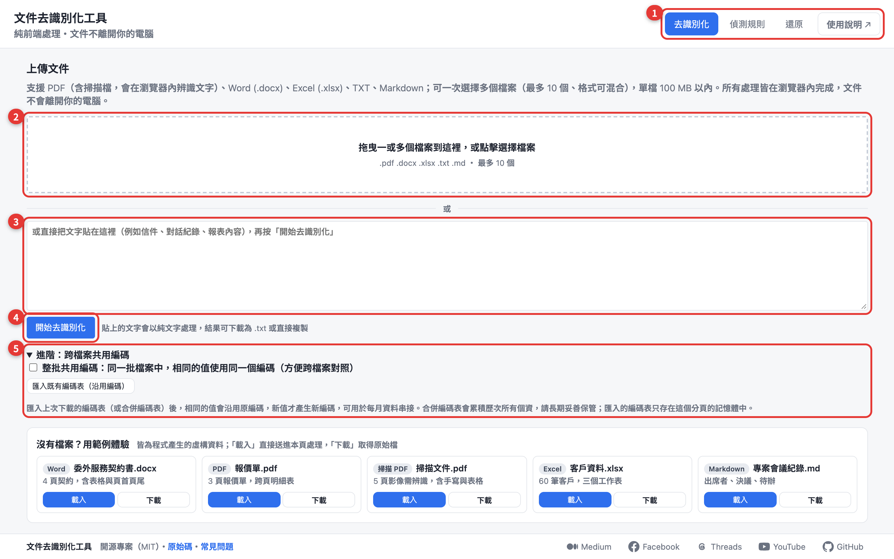

1. 三個頁籤：**去識別化**（主要流程）、**偵測規則**（管理規則）、**還原**（用編碼表復原）。
2. 把檔案拖進虛線區或點擊選擇。支援 `.pdf`（含掃描檔）、`.docx`、`.xlsx`、`.txt`、`.md`，單檔 100 MB 以內；選到超過上限的檔案會跳出警告視窗列出檔名，按「我知道了」後其餘檔案照常處理。
3. 或直接把文字（信件、對話紀錄、報表內容）貼在文字框，
4. 按「開始去識別化」（或 Ctrl/⌘+Enter）。貼上的文字以純文字處理，結果可下載為 `.txt`，也可用「更多 → 複製去識別化文字」一鍵複製。
5. **進階：跨檔案共用編碼**（選用，處理中也可以在「輸出設定」的「進階：編碼範圍」切換）：勾選「整批共用編碼」後，同一批檔案中相同的值會使用同一個編碼；按「匯入既有編碼表」可沿用上次的編碼（新值才產生新編碼），適合每月資料串接。合併編碼表會累積歷次所有個資，請妥善保管。

可以一次選擇多個檔案（格式可混合，**最多 10 個**）：


1. 左側檔案面板列出所有檔案、格式與偵測筆數，
2. 點擊即切換預覽與編輯的檔案（每個檔案各自有獨立的偵測結果與編碼表），
3. 「＋ 加入檔案」可再補檔案（含貼上的文字），× 可移除，
4. 「打包下載全部」把每個檔案的去識別化檔與編碼表連同 `清單.csv`（對照表）打包成一個 ZIP。

### 步驟 2：檢視預覽與輸出設定

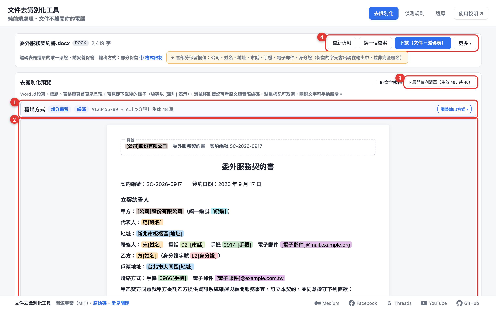

1. **輸出設定**：平常收合成一行摘要（保留與標記方式、範例與生效筆數），按右側的「調整 ▾」展開（見下方）；展開後按鈕變成藍底的「收合 ▴」，偵測清單的展開按鈕也一樣。
2. **預覽區**：依檔案格式呈現，Word 顯示段落、標題、表格與頁首頁尾（如上圖的 4 頁合約書）。**預覽就是下載後的樣子**，只是編碼以類別名稱表示：部分保留（預設）時是 `王[姓名]`、`A1[身分證]`，全部隱藏時是 `[姓名]`。
3. **展開偵測清單**：清單預設收合；展開後列出每一筆的類別、原文與輸出，點擊任一筆會捲動到預覽中的位置並閃爍強調。
4. **重新偵測**（規則變更後重跑，手動新增的項目會保留）／**換一個檔案**／**下載**／**更多**都在上方工具列。

展開「輸出設定」可以決定下載檔中每筆資料要露出多少、隱藏的部分寫成什麼，整批檔案一起套用：

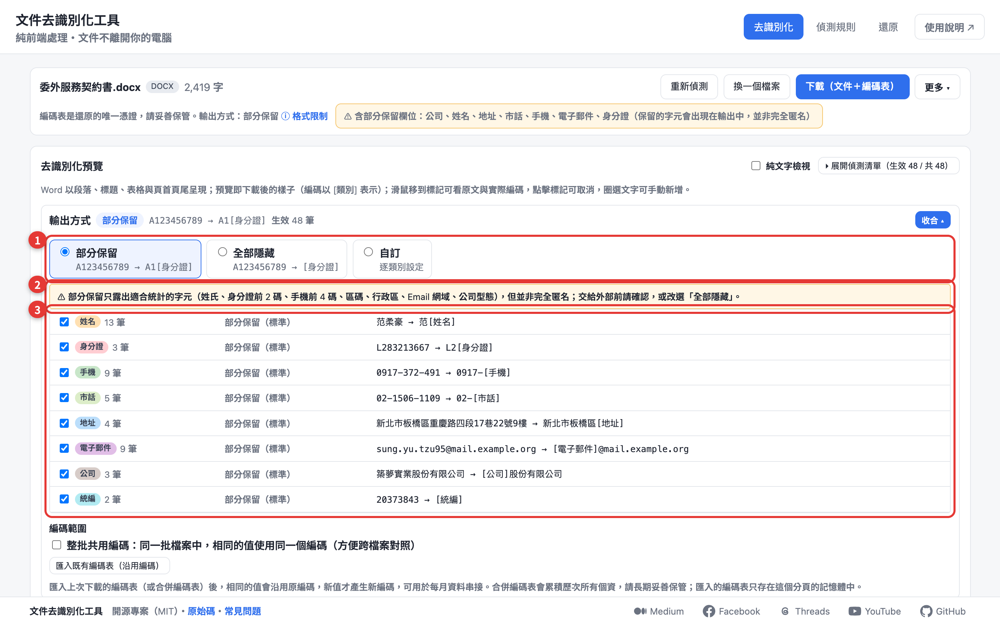

1. 兩列選擇，右側即時顯示範例。**保留**：**部分保留**（預設，`A123456789 → A1[身分證]`）／**全部隱藏**（`[身分證]`）／**自訂**（逐類別設定）；**標記**：**編碼**（預設，可還原）／**類別**／**空白佔位**（見下方）。部分保留只露出適合統計、較難反查個人的部分：姓氏、身分證前 2 碼（地區＋性別）、手機前 4 碼（電信業者）、市話區碼、縣市＋鄉鎮市區、Email 網域、公司組織型態（如「股份有限公司」）、識別碼第 1 碼；統一編號全部隱藏。
2. 需要注意的事合併成一行提醒，例如部分保留並非完全匿名；交給外部前請確認，或改選「全部隱藏」。
3. **依類別調整**（平常收合）：每個類別一列，顯示筆數、套用的保留方式與範例輸出。取消勾選即整類不去識別化（套用到所有檔案）。
4. **進階：編碼範圍**（只在標記為「編碼」時出現）：整批共用編碼、匯入既有編碼表，見下方說明。

選 **自訂** 時，「依類別調整」會自動展開，可以逐類別調整保留多少：

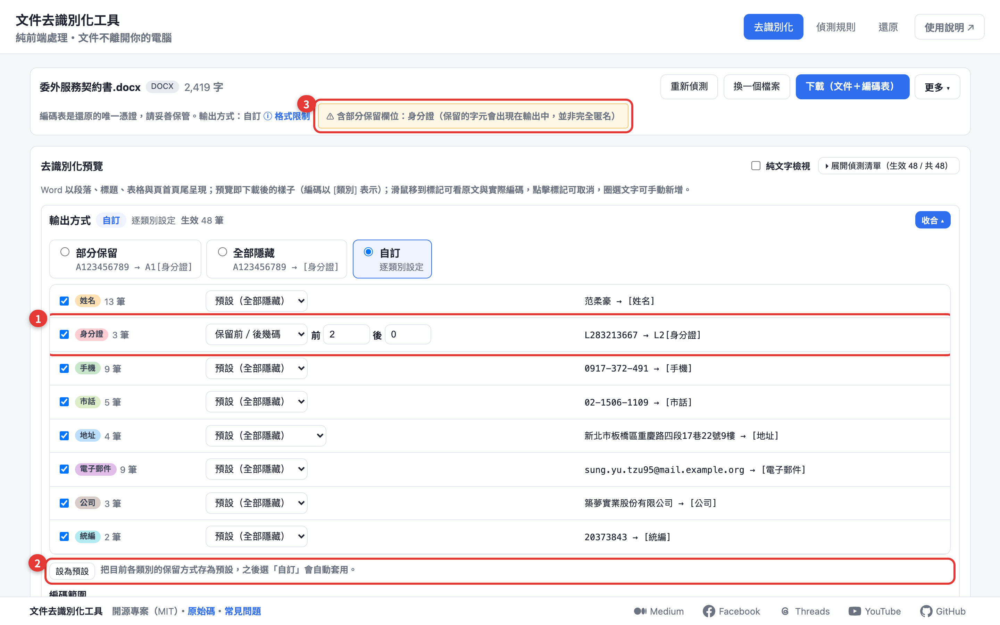

1. 例如把身分證改為「保留前 2 碼」，右側即時顯示 `L283213667 → L2[身分證]`，下載後可在 Excel 用 `LEFT(儲存格,2)` 統計地區與性別。可選全部隱藏、保留前／後幾碼、以分隔字元為界（例如 Email 保留 `@` 之後）、保留姓氏、保留到縣市或縣市＋鄉鎮市區、部分保留（標準）；有錯誤或風險時直接在該列提示。
2. **設為預設**：把目前各類別的保留方式存在瀏覽器，之後選「自訂」會自動套用（「偵測規則」頁按「查看規則」可看到各規則的預設保留）。
3. 只要有部分保留，工具列的狀態列會以警示色顯示「⚠ 含部分保留（N 類）」，滑鼠停留可看是哪些類別。

**標記** 那一列決定隱藏的部分寫成什麼、日後能不能還原：

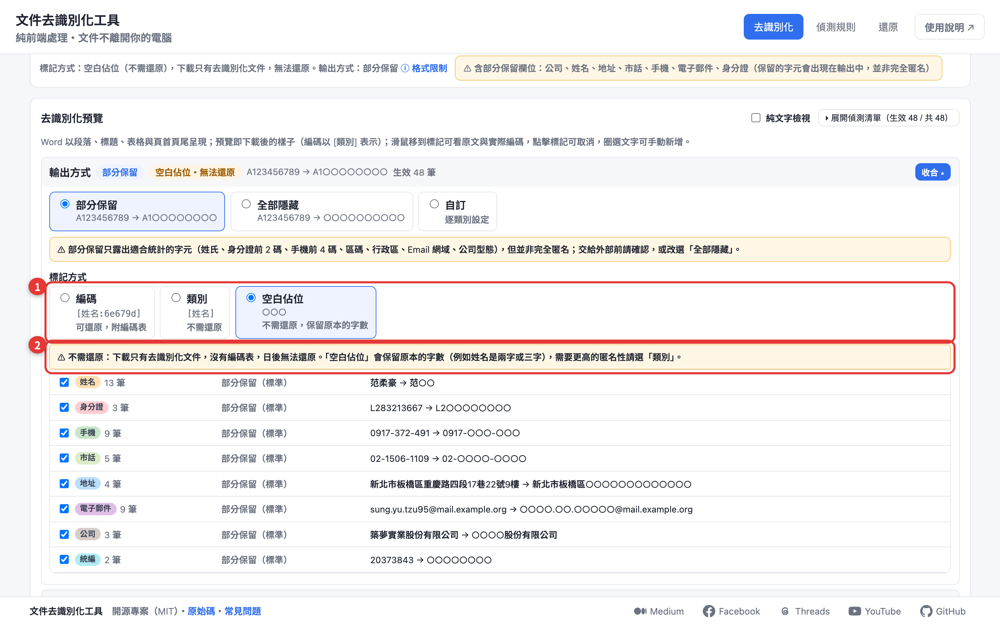

1. 三選一：**編碼** `[姓名:6e679d]`（預設，可還原，下載附編碼表）／**類別** `[姓名]`（不需還原）／**空白佔位** `○○○`（不需還原，每個字或數字換成「○」，分隔符號保留）。
2. 選了不需還原的方式時，提醒會加上：下載只有去識別化文件、沒有編碼表，日後無法還原；「空白佔位」會保留原本的字數（例如看得出姓名是兩字或三字），需要更高的匿名性請選「類別」。
3. 狀態列同步顯示目前的設定，例如「部分保留・空白佔位（無法還原）」。

選好之後，預覽與下載都跟著改變：

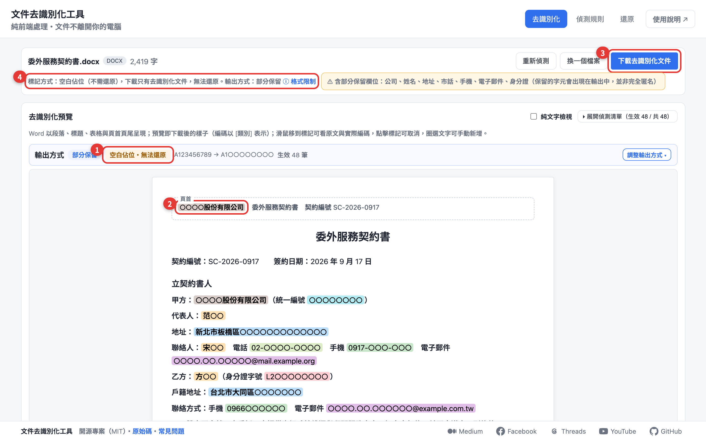

1. 輸出設定的摘要標示「空白佔位・無法還原」；
2. 預覽直接顯示輸出內容，例如 `○○○○股份有限公司`、`范○○`、`0917-○○○-○○○`（滑鼠停留仍可看原文）；
3. 下載鈕變成「下載去識別化文件」，只下載文件；多檔時打包的 ZIP 也只有文件與清單；
4. 狀態列註明「無法還原」，「進階：編碼範圍」、只下載編碼表等與還原有關的選項都會隱藏。改回「編碼」就恢復原本的設定。

怎麼選：日後要把結果對回原始資料（例如外包處理後再還原、每月資料串接）用 **編碼**；只是交給外部閱讀或給 AI 摘要用 **類別**；要保留版面與字數感、像公文遮蔽用 **空白佔位**。

使用編碼時，**進階：編碼範圍** 可以隨時切換整批共用編碼或匯入編碼表，切換後所有檔案的編碼會重新配置。切換保留方式同樣會讓保留字元改變的項目換成新編碼（每個編碼只對應一種被隱藏的片段，才能正確還原），所以請用「下載（文件＋編碼表）」一次取得成對的檔案。

Excel 以工作表格線呈現，可切換工作表（下圖 1、2），右上角可切換「純文字檢視」與偵測清單（3）：

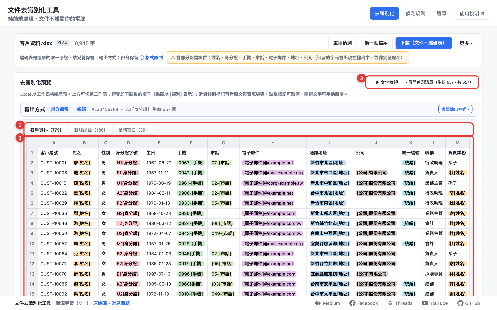

PDF 依原始座標逐頁排版（下圖 1 頁碼、2 頁面），表格與版面與原檔一致：

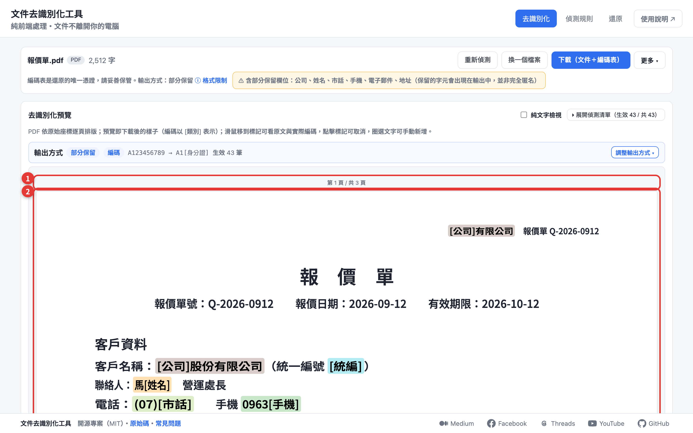

**掃描檔（圖片型 PDF）**：沒有文字層的 PDF 會自動改用文字辨識，出現專屬的辨識畫面：

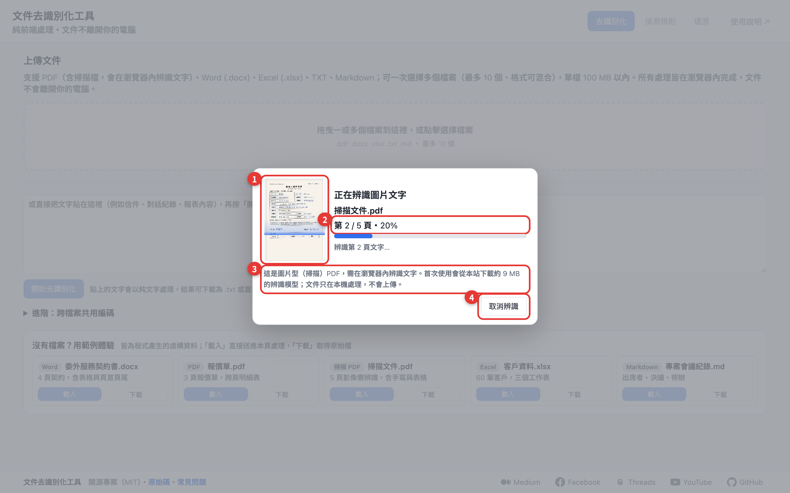

1. 目前辨識的頁面縮圖（掃描線動畫）；
2. 第幾頁／共幾頁與整體進度，下方顯示目前步驟（判斷方向並轉正、辨識文字、分析表格與勾選框）；
3. 說明：首次使用會從本站下載約 9 MB 的辨識模型，文件只在本機處理；
4. 隨時可以「取消辨識」，該檔不會加入，同批的其他檔案照常載入。

辨識完成後與一般 PDF 相同：自動偵測、預覽、取消、圈選新增都一樣。

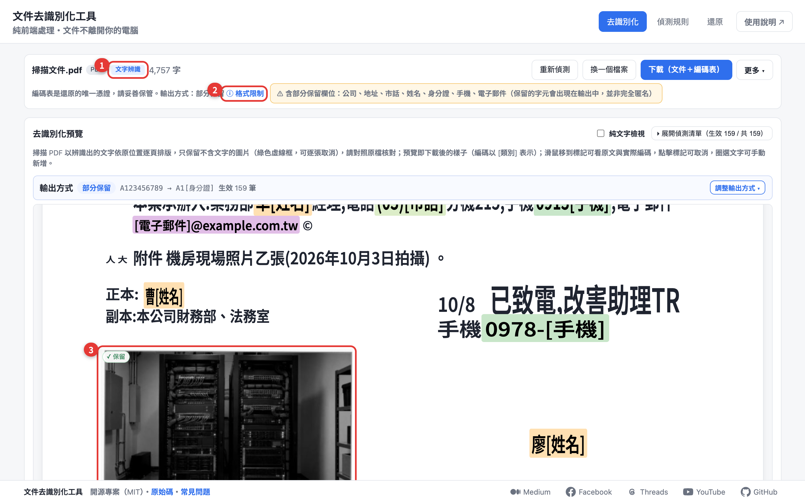

1. 格式旁標示「文字辨識」；
2. 「ⓘ 格式限制」說明辨識可能有誤，請逐頁核對、手動補上漏抓的項目；
3. 照片、標誌等**不含文字的圖片**以綠色虛線框標出，會以原影像保留在下載檔中；含文字的區域（印章、手寫、表格）不會保留影像。點圖片左上角的「✓ 保留」可逐張取消（例如照片中有人臉或證件），取消後下載檔就不含該圖。

表單、表格類的掃描頁會一併還原版面結構，預覽與下載檔相同：

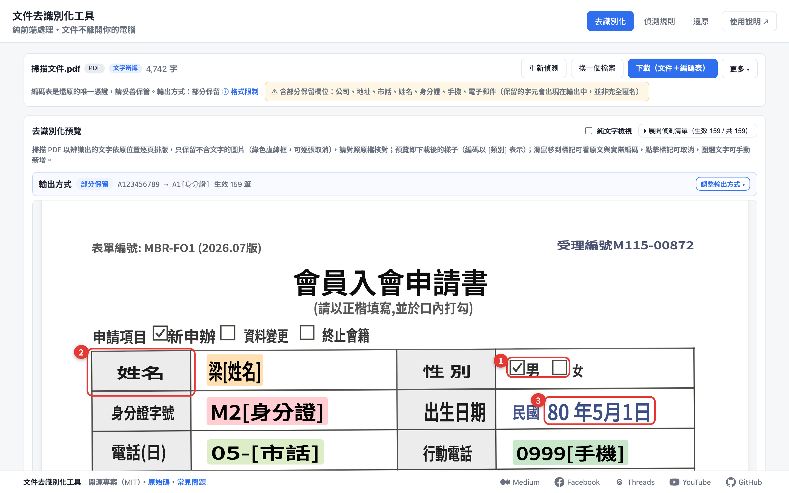

1. 勾選框以方框＋勾號重繪，保留勾選狀態；方框旁的選項文字（男、女）照常辨識，不會變成「口」「[」「了」之類的雜字；
2. 表格框線與儲存格底色依原位置、粗細與顏色重繪；
3. 文字沿用原稿的顏色，例如藍筆手寫。

整頁傾斜或掃描時放反（90°／180°）會先自動轉正再辨識；不到 1° 的輕微傾斜照原樣辨識（轉正反而會讓辨識變差），但線條、底色、勾選框仍完整還原。

還原只還原文字：還原後的檔案是文字版面重建，不含保留的圖片、線條與勾選框。

### 步驟 3：查看原文與實際編碼


1. 滑鼠移到任何標記上，tooltip 顯示「類別｜原文｜輸出標記」，輸出標記就是下載檔中的樣子，例如 `[姓名:a3f9c2]`。

### 步驟 4：人工調整（取消誤判、整類取消、新增漏抓）

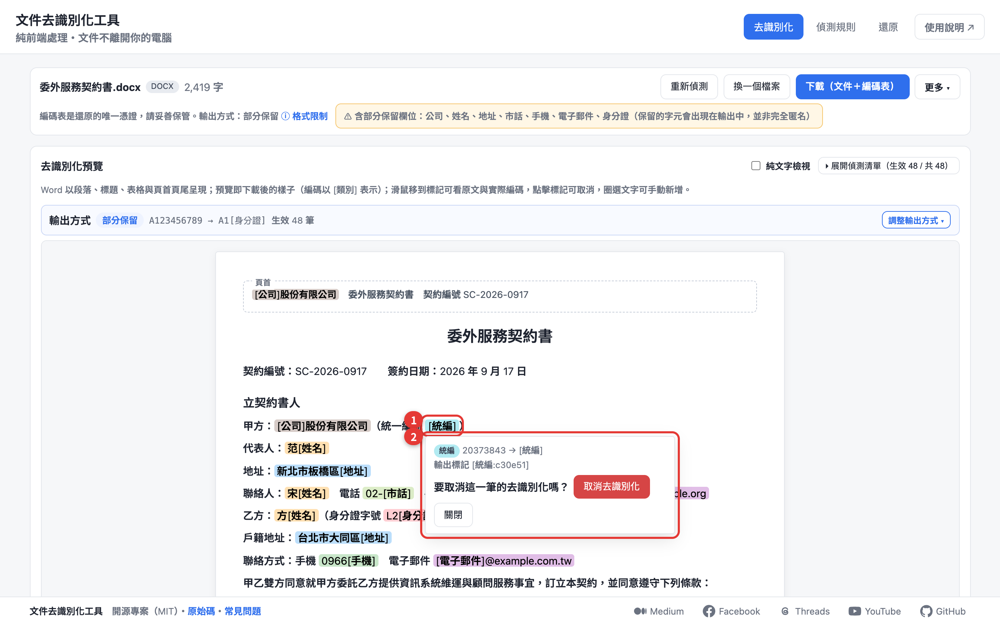

1. 點擊預覽中任何一個已去識別化的標記，
2. 會跳出確認視窗顯示類別、原文與輸出標記；按「取消去識別化」即恢復原文（已取消的項目再點一次可「加回」）。

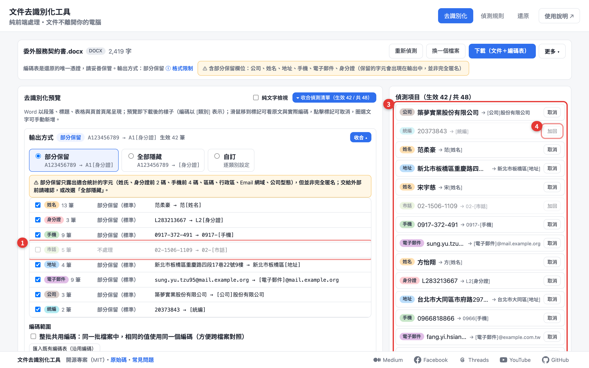

1. 在「輸出設定」的「依類別調整」取消勾選某類別（例如「市話」），該類別全部取消；再勾選即復原。
2. 被取消的項目在預覽中恢復原文並以紅色虛線標示。
3. 展開偵測清單可逐筆檢視，
4. 清單中的 **取消／加回** 按鈕同樣可切換單筆。

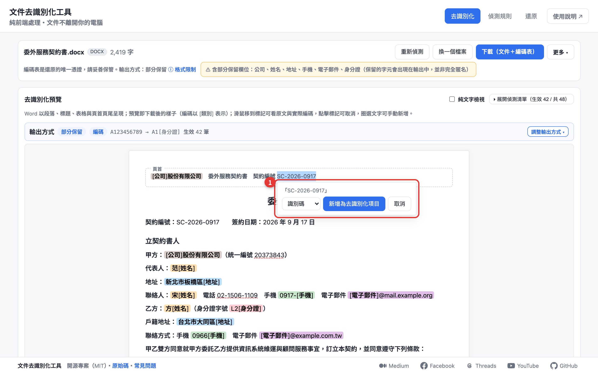

1. 在預覽中用滑鼠圈選任何文字，會跳出浮動視窗：選擇類別後按「新增為去識別化項目」，該段文字即被加入（若與既有項目重疊會提示）。手動新增的項目和同類別的其他項目套用相同的保留方式。

### 步驟 5：下載去識別化文件與編碼表

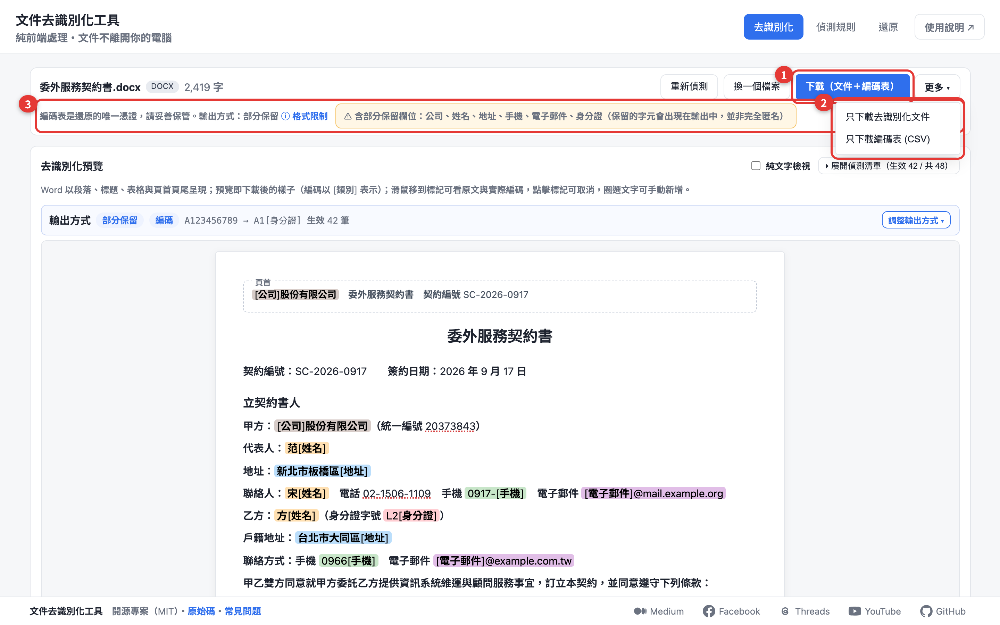

1. **下載（文件＋編碼表）** 一次下載去識別化文件（格式與上傳相同，檔名加 `.deid`）與編碼表（`*.mapping.csv`），確保兩者成對。多個檔案時主要按鈕是「打包下載全部」。瀏覽器第一次可能會詢問是否允許下載多個檔案。
2. **更多**：只下載文件、只下載編碼表、複製去識別化文字（TXT／Markdown）、下載合併編碼表（開啟共用編碼或匯入編碼表時）。若單獨下載的檔案和先前下載的另一份不是同一個版本，會提醒你重新下載。
3. **狀態列**：一行顯示目前的保留與標記方式（是否可還原、是否整批共用編碼），有部分保留時以警示色提示；滑鼠停在「ⓘ 格式限制」可看 PDF／Excel／Word 的限制，停在下載鈕上可看「編碼表是還原的唯一憑證」的提醒。尚未下載就關閉或重新整理頁面時會跳出提醒。

### 步驟 6：管理偵測規則

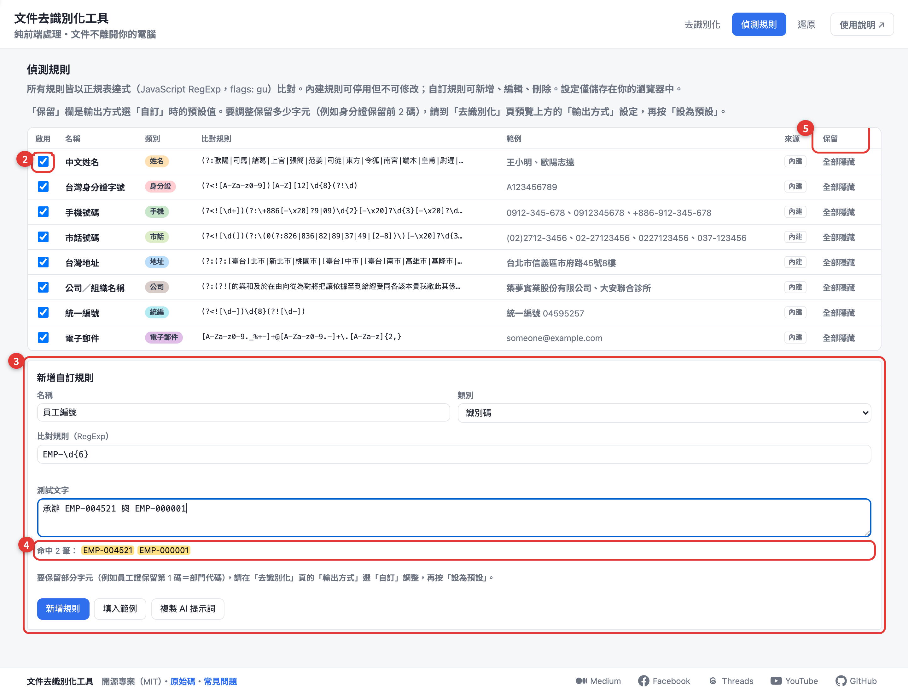

1. 按右上角的 **＋ 新增自訂規則** 打開表單：名稱、類別、比對規則（JavaScript RegExp）；無效的規則會即時顯示錯誤並拒絕儲存，按「取消」收起。不知道規則怎麼寫？按 **填入範例** 會用預設的「員工編號」規則填滿表單；滑鼠停在 **複製 AI 提示詞** 上可預覽提示詞，點一下即複製，貼給 ChatGPT／Claude／Gemini 就能拿到可直接貼回的規則。
2. 在「測試文字」貼上樣本即時看到命中結果。設定只存在你的瀏覽器，重新整理後仍保留。
3. 規則依 **台灣格式／國際與通用格式／自訂規則** 分組，點標題可收合；右側「全部啟用」可整組啟用或停用。
4. 每條規則一行：開關、名稱、類別、範例。勾選框可個別啟用／停用（內建規則不可修改或刪除）。
5. **查看規則** 展開完整的比對規則、檢核方式（例如身分證檢核碼）、在「自訂」下的預設保留方式與來源；預設保留為唯讀，要修改請到去識別化頁的「輸出設定」調整後按「設為預設」。自訂規則在這裡編輯或刪除。

### 步驟 7：用編碼表還原

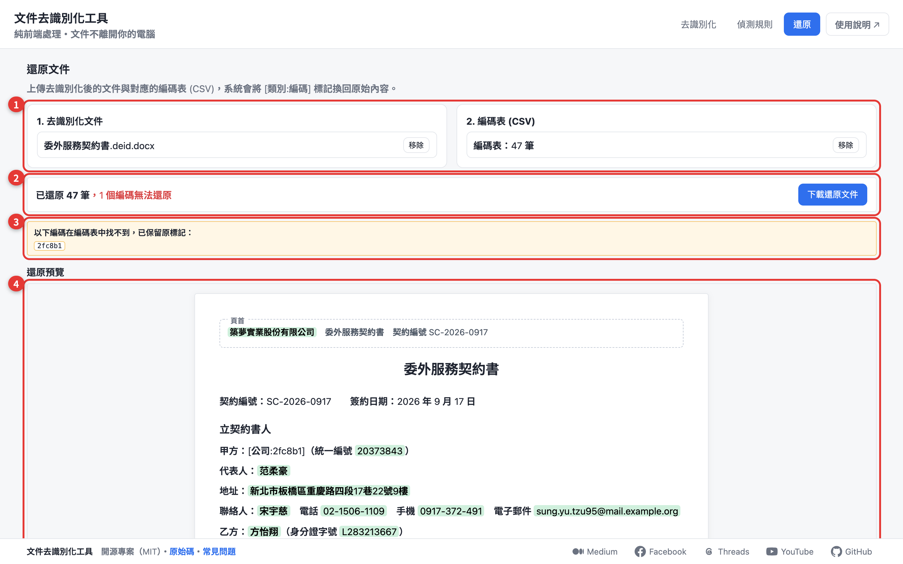

1. 上傳去識別化文件與對應的 CSV 編碼表（順序不拘，兩者齊全即自動還原）。
2. 顯示已還原筆數；點「下載還原文件」取得同格式的還原檔（檔名加 `.restored`）。
3. 若文件中有編碼在 CSV 找不到，會列出無法還原的編碼並保留原標記；若文件裡完全沒有編碼（以「類別」或「空白佔位」輸出的檔案），會提示這類檔案無法還原。
4. 還原預覽：被換回的原文以綠色標示。

## 支援格式與限制

| 格式 | 輸入 | 輸出 | 限制 |
|------|------|------|------|
| TXT / Markdown / 貼上文字 | ✅ | 同格式 | — |
| Word | 僅 `.docx` | `.docx`，樣式／表格／頁首頁尾完整保留 | 不支援舊版 `.doc`；文字方塊、註解可能未涵蓋 |
| Excel | 僅 `.xlsx` | `.xlsx`，儲存格樣式與工作表結構保留；被取代的儲存格改為 inline string，未再引用的共用字串會清空 | 僅處理文字型儲存格：以數值儲存的電話／證號、公式結果、工作表名稱、註解不在範圍 |
| PDF | 含文字層 | `.pdf`，文字依原座標重建，內嵌 Noto Sans TC 子集 | 圖片、圖形、原字型不保留 |
| 掃描 PDF | 整份沒有文字層（掃描、拍照轉檔） | `.pdf`，辨識出的文字依原位置與顏色重建，表格框線、底色與勾選框重繪，保留不含文字的圖片 | 辨識可能誤認或遺漏（手寫、模糊時更明顯；傾斜 10° 以內與 90°／180° 轉向會自動轉正），請逐頁核對；部分頁面才有文字層的混合型 PDF 只處理文字層；還原頁不辨識掃描檔 |

其他：單檔上限 100 MB（全部在瀏覽器記憶體內處理，過大的檔案在手機上可能失敗）、單次最多 10 個檔案；還原一次處理一份；規則以台灣格式為主。中文姓名與地址無法以規則做到零誤判／零漏抓，請務必在預覽中人工覆核。

## 偵測規則

| 類別 | 內建規則 | 精確度設計 |
|------|----------|------------|
| 姓名 | 常見姓氏（含複姓）＋ 1–2 字名 | 先以後綴語境（先生、表示、於…）判斷，否則退回排除虛詞的雙字比對；停用詞表（高雄、方法…）；「甲方／乙方／雙方」的「方」不視為姓氏 |
| 身分證 | `[A-Z][12]\d{8}` | 檢核碼驗證，錯誤者不命中 |
| 手機 | `09xx-xxx-xxx`、`0912345678`、`+886-9xx…` | 前後不得緊鄰數字 |
| 市話 | `(02)2712-3456`、`02-27123456`、`0227123456`… | 無分隔形式依區碼要求精確位數，8 位數統編不會被誤判為市話 |
| 地址 | 縣市＋鄉鎮市區＋路街段巷弄號樓 | 縣市名為錨點，避免吃到前面的句子 |
| 電子郵件 | 標準格式 | — |
| 公司／組織 | 以「股份有限公司、有限公司、企業社、事務所、診所、基金會…」結尾 | 排除「本／該／貴公司」與前置虛詞 |
| 統一編號 | 8 位數 | 統一編號檢核碼（2023 年新制含舊制例外） |
| 識別碼 | 自訂 RegExp | 例如 `EMP-\d{6}`、`MRN-\d{4}-\d{5}` |
| 國際電話 | `+` 加國碼的各國號碼，或北美 `(415) 867-5309`、`415-867-5309` | 以 [libphonenumber-js](https://gitlab.com/catamphetamine/libphonenumber-js)（Google 電話號碼規則資料）驗證號碼有效性；+886 號碼歸手機／市話；號碼後面緊接其他數字時只取有效的部分。部分保留露出國碼（北美為區碼） |
| 信用卡 | 13–19 位，可用空白或連字號分組 | Luhn 檢核＋發卡機構號段（Visa、Mastercard、AmEx、Discover、JCB、UnionPay、Diners）＋常見分組格式。部分保留露出末 4 碼 |
| SSN | `123-45-6789`、`123 45 6789`，或「SSN:」後的 9 位數 | 排除 000、666、9xx 區碼與 00 組碼、0000 序號。全部隱藏 |
| IBAN | `GB82 WEST 1234 5698 7654 32`、`DE89370400440532013000` | mod-97 檢核碼＋各國固定長度。部分保留露出國別碼 |
| IP | IPv4、IPv6 | IPv4 各段 0–255，排除版本號；IPv6 以瀏覽器內建的網址解析驗證，排除時間與 MAC 位址。部分保留露出前兩段 |
| 生日 | DOB、Date of Birth、Birthday、Born、出生日期、生日等標籤後的日期 | 標籤與日期在同一行（或表格的下一格）；支援 YYYY-MM-DD、MM/DD/YYYY、March 14, 1985、民國 80 年 5 月 1 日等寫法；沒有標籤的日期不偵測。部分保留露出年份 |

命中重疊時較長者優先。所有規則都在「偵測規則」頁籤公開可檢視、可停用。網址、護照與駕照號碼、英文姓名與地址目前沒有內建規則（沒有可靠的格式或需要語言模型），可自訂規則或在預覽中圈選新增。

## 輸出格式：標記與編碼表

- 文件中每筆敏感資訊以 `[類別:編碼]` 取代，例如 `[姓名:a3f9c2]`；編碼為 6 位小寫十六進位。標記方式選「類別」時寫成 `[姓名]`、選「空白佔位」時寫成 `○○○`，這兩種不產生編碼表、無法還原。
- **同一類別下完全相同的值共用同一個編碼**：`王小明` 在文件中出現三次，會全部變成同一個 `[姓名:a3f9c2]`，編碼表只列一列。自動偵測與手動新增走同一套規則，圈選新增的文字若與既有項目的類別、內容完全相同，就沿用既有編碼。
- 值有任何差異（大小寫、空白、標點）或類別不同，就是不同編碼；編碼以單一文件為範圍，不同檔案之間不共用。
- 編碼表為 UTF-8（含 BOM）、RFC 4180 的 CSV，Excel 可直接開啟：

  ```csv
  code,category,original
  a3f9c2,姓名,王小明
  7b21e8,身分證,A123456789
  c882d1,地址,"台北市信義區市府路45號, 8樓"
  ```

- 採部分保留時，`original` 只記錄被隱藏的片段，並在尾端加上 `kept_prefix`、`kept_suffix` 兩欄（全部隱藏時不輸出這兩欄，格式與舊版相同）；編碼以「類別＋完整原值＋保留切分」判斷是否共用。
- 還原時以 `code` 查表；文件中查無的編碼保留原標記並列出警告。格式契約見 `specs/001-doc-deidentify/contracts/`。

## 範例檔下載與體驗

想先試試看？直接下載下面的範例（全部為程式產生的**虛構資料**，姓名、公司、地址、電話、證號均非真人），或在網頁的「沒有檔案？用範例體驗」區塊按「載入體驗」一鍵送進處理：

| 範例 | 格式 | 內容 | 下載 |
|------|------|------|------|
| 委外服務契約書 | Word | 4 頁契約：立契約書人、十二條條款、附件表格、簽署欄（含頁首頁尾） | [contract.docx](https://chuoneone.github.io/sped-deidentification/samples/contract.docx) |
| 委外服務契約書 | PDF | 同一份契約的 PDF 版本 | [contract.pdf](https://chuoneone.github.io/sped-deidentification/samples/contract.pdf) |
| 報價單 | Word | 3 頁報價單：客戶資料、20 項明細（跨頁表格）、聯絡窗口、簽回欄 | [quotation.docx](https://chuoneone.github.io/sped-deidentification/samples/quotation.docx) |
| 報價單 | PDF | 同一份報價單的 PDF 版本 | [quotation.pdf](https://chuoneone.github.io/sped-deidentification/samples/quotation.pdf) |
| 客戶資料 | Excel | 60 筆客戶＋聯絡紀錄 30 筆＋業務窗口，三個工作表 | [customers.xlsx](https://chuoneone.github.io/sped-deidentification/samples/customers.xlsx) |
| 客服信件 | TXT | 客服回覆信與引用的原始來信 | [support-email.txt](https://chuoneone.github.io/sped-deidentification/samples/support-email.txt) |
| 專案會議紀錄 | Markdown | 出席者、決議表格、待辦清單 | [meeting-notes.md](https://chuoneone.github.io/sped-deidentification/samples/meeting-notes.md) |
| 掃描文件 | 掃描 PDF | 5 頁純影像（需辨識）：中文信函（含手寫批註與機房照片）、藍筆手寫的會員申請表、橫式名冊表格、英文 Invoice（品項金額表、產品照片）、中英雙語名片；模擬掃描的灰階／彩色、輕微傾斜與紙張底色 | [scanned.pdf](https://chuoneone.github.io/sped-deidentification/samples/scanned.pdf) |
| 還原體驗 | Word + CSV | 已去識別化的契約書與其編碼表（在「還原」頁籤載入） | [contract.deid.docx](https://chuoneone.github.io/sped-deidentification/samples/contract.deid.docx)、[contract.mapping.csv](https://chuoneone.github.io/sped-deidentification/samples/contract.mapping.csv) |

更多情境（人工調整、錯誤 CSV、自訂規則、格式邊界）的範例在 `examples/`，說明見 [examples/README.md](examples/README.md)；`npm run examples` 可重新產生全部範例。

## 開發

需求：Node.js 20+（建議 22）。

```bash
npm install
npm run dev          # 開發伺服器 http://localhost:5173
npm test             # Vitest：單元 + round-trip 整合測試
npm run build        # 型別檢查 + 產出 dist/
npm run preview      # 試跑 dist/（http://localhost:4173）
npm run fixtures     # 重新產生 tests/fixtures 的 docx/xlsx/pdf
npm run examples     # 重新產生 examples/（含掃描範例、角度樣本 tests/fixtures/scan-angles.pdf 與兩者的原稿；需本機 Chrome）
npm run screenshots  # 重新產生 docs/screenshots/（需先 build + preview；使用本機 Chrome）
npm run eval:ocr     # 以原稿為答案，評分網站實際的掃描檔辨識（需先 build + preview；加 -- --verbose 列出漏抓與誤判，-- --sample main|angles 只跑其中一份）
npm run og           # 重新產生 public/og.png（社群分享圖，使用本機 Chrome）
```

本專案以 [spec-kit](https://github.com/github/spec-kit) 的規格驅動流程開發：`specs/001-doc-deidentify/`（之後的功能在 `specs/002-…`～`specs/007-intl-pii-patterns/`）內有規格（spec）、研究決策（research）、實作計畫（plan）、資料模型、契約與任務清單；`.specify/memory/constitution.md` 是專案憲章（純前端零外傳、可還原、人工覆核必經、規則透明）。

## 測試與品質

- **372 個自動化測試**（33 個檔案）：每條內建規則的命中／不命中樣本、身分證與統編檢核碼、編碼唯一性、CSV round-trip、偵測重疊裁決與人工增刪、規則設定持久化、遮罩格式、預覽渲染、TXT／DOCX／XLSX／PDF 的「去識別化 → 還原」逐字元 round-trip、真實案例（多頁合約書／報價單、60 筆客戶資料）的偵測完整性（身分證／Email／手機 100%）、批量打包；掃描範例以真實 Tesseract 辨識後的偵測命中率（≥ 90%）、文字重建不重疊、保留圖片與還原，以及框線移除、字形校正、圖片偵測、漏字補辨識、線條／底色／勾選框偵測、傾斜與方向判斷等辨識演算法的單元測試；結構重繪的輸出也驗證不含點陣影像、文字還原不變；三種標記方式在各格式的輸出都驗證過，不需還原的輸出不含任何編碼與被隱藏的內容、打包時不含編碼表；國際格式（電話、信用卡、SSN、IBAN、IP、生日）的校驗與英文範例零誤判；輸出設定與偵測規則頁的分組、收合與整組啟停。
- **掃描檔辨識評分**：掃描範例由 HTML 產生，產生時一併輸出「原稿」（各頁實際文字、應偵測的印刷／手寫值、應保留的圖片位置，以及表格線段、底色與勾選框）；另有信函與表單以 3°、6° 傾斜及 90°、180° 轉向產生的角度樣本。`npm run eval:ocr` 在真實瀏覽器裡跑網站，逐頁回報字元召回／精確率（不計順序、全半形視為相同）、個資命中、讀錯但仍遮蔽、誤判、圖片保留、線段召回／精確、底色命中、勾選框（位置與勾選狀態）與文字段重疊數。目前：
  - 主範例：字元 99.1%／99.4%、印刷值 138/144、手寫值 10/12、誤判 2、圖片 4/4、線段 66/66（多畫 1）、底色 18/18、勾選框 10/10（狀態全對、無誤判）、文字重疊 0，5 頁約 22 秒；
  - 角度樣本的字元召回率：3° 為 98.4%／96.9%（信函／表單）、6° 為 97.7%／96.0%、90° 為 97.7%、180° 為 98.3%。
- **輸出零殘留**的回歸測試：Excel 共用字串、PDF 原始位元組、Word 各 part 皆確認不含任何原始敏感值。
- 端對端驗證紀錄：`specs/001-doc-deidentify/checklists/e2e-validation.md`。
- CI：每次 push 到 `main` 跑測試與建置，通過後自動部署 GitHub Pages。

## 專案結構

```text
src/
├── core/        偵測規則、偵測引擎、編碼、CSV、遮罩、還原、規則設定
├── formats/     txt/md、docx、xlsx、pdf 解析與產出、TTF 稀疏子集、批量打包
└── ui/          三個頁籤、格式感知預覽、共用元件
tests/           unit / integration / fixtures / helpers
examples/        各情境範例檔（虛構資料）
scripts/         範例產生器（文件模型 → docx/pdf、HTML → 模擬掃描 PDF）、截圖腳本
scripts/assets/scan/  掃描範例用的圖片原檔（以 Codex 生成，不含文字與人物）
specs/           spec-kit 規格、計畫、任務、契約、驗證紀錄
public/fonts/    Noto Sans TC（PDF 輸出用）
```

技術：TypeScript + Vite（無 UI 框架）、`pdfjs-dist`（PDF 文字擷取與掃描頁渲染）、`tesseract.js`（瀏覽器內 OCR，模型 `@tesseract.js-data/chi_tra`、`eng`）、`pdf-lib` + `@pdf-lib/fontkit`（PDF 輸出）、`jszip`（.docx / .xlsx / ZIP）、Vitest；截圖腳本使用 `puppeteer-core` 驅動本機 Chrome。

## 部署

`.github/workflows/deploy.yml`：push 到 `main` → `npm ci` → `npm test` → `npm run build` → 部署 `dist/` 到 GitHub Pages。Vite 設定 `base: './'`，所以在任何子路徑（如 `/data-deidentification/`）或以檔案方式開啟都能運作。

SEO／AEO／GEO：`index.html` 內含 description、canonical、Open Graph／Twitter Card（`public/og.png`）、JSON-LD（`WebSite`、`WebPage`、`WebApplication`、`SoftwareSourceCode`、`FAQPage` 與作者 `Person`），以及一段靜態的「關於／使用方式／支援格式／常見問題」內容：不需要 JavaScript 就能被搜尋引擎與 AI 爬蟲讀到，載入後收進頁尾「常見問題」開啟的彈窗（FAQ 的 JSON-LD 與頁面文字須保持一致）。`public/robots.txt` 與給 LLM 讀的站台摘要 `public/llms.txt` 隨站台部署；`public/sitemap.xml` 的 `__BUILD_DATE__` 佔位由 `vite.config.ts` 在建置時換成當天日期作為 `lastmod`。

## 授權

- 字型 `public/fonts/NotoSansTC-Regular.ttf`：Noto Sans TC，© Google，[SIL Open Font License 1.1](https://openfontlicense.org/)。PDF 輸出時以自製的「稀疏子集」只內嵌用到的字形（`src/formats/ttf-subset.ts`，保留原始 glyph ID）；不使用 pdf-lib 內建 subset，因其對大型 CJK 字型的輸出在 macOS 預覽程式會顯示亂碼。
- 文字辨識：[tesseract.js](https://github.com/naptha/tesseract.js) 與 tesseract.js-core（Apache-2.0），語言模型為 Tesseract `tessdata_best` 的 int 版本（Apache-2.0），建置時由 `vite.config.ts` 複製到站台的 `ocr/`。
- 掃描範例：手寫字以 [霞鶩文楷 TC](https://github.com/lxgw/LxgwWenkaiTC)、英文簽名以 [Caveat](https://fonts.google.com/specimen/Caveat) 繪製（皆為 SIL OFL 1.1，只在產生範例時使用，網站不載入）；照片與標誌為 Codex 生成的圖片。
- 本專案以 [MIT License](LICENSE) 授權，保留原作者 Dean Lin 的著作權聲明；學校與特教文件相關修改 © chuoneone。
- 範例文件中的人名、公司、地址、電話、證號皆為程式產生的虛構資料。

## 原作者

本工具改自 Dean Lin 的 [文件去識別化工具](https://github.com/dean9703111/data-deidentification)。原作者 Dean Lin — 歡迎追蹤與交流：

| 平台 | 連結 |
|------|------|
| Medium | <https://medium.com/@dean-lin> |
| Facebook | <https://www.facebook.com/deanlinbao> |
| Threads | <https://www.threads.com/@deanlin5288> |
| YouTube | <https://www.youtube.com/@dlcorner> |
| GitHub | <https://github.com/dean9703111> |

如果這個工具對你有幫助，歡迎到[原專案](https://github.com/dean9703111/data-deidentification)給個 ⭐。
